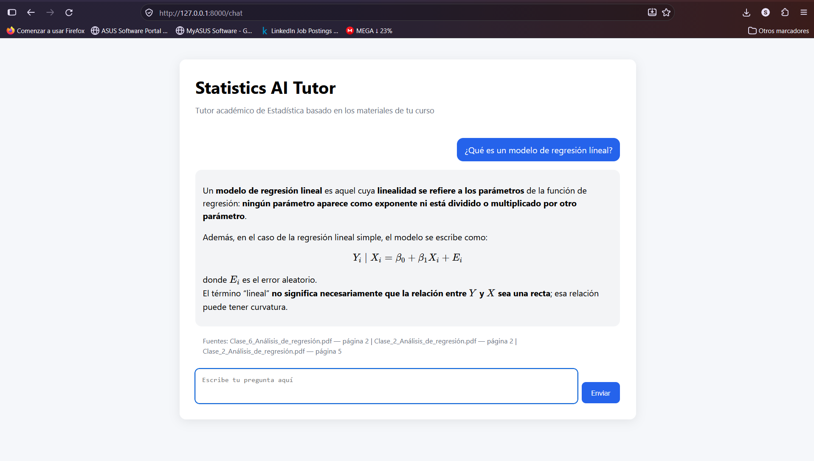

# Statistics AI Tutor

**An end-to-end Retrieval-Augmented Generation (RAG) application for learning Statistics from course materials.**

Statistics AI Tutor is an open-source academic assistant that combines semantic retrieval over PDF notes with LLM-generated answers, source references, and deterministic statistical calculations through a FastAPI application.

> **Project status:** Active development. The current version includes multi-document PDF ingestion, chunking, OpenAI embeddings, cosine-similarity retrieval, RAG answer generation with sources, an embedding cache, a FastAPI REST API, a browser-based chat interface, retrieval evaluation, and a local calculation route for simple linear-regression prediction.

## Application preview

The current web interface allows students to ask questions in natural language and receive grounded answers based on the available course material, including mathematical notation and document/page references.



## Why this project

The goal is to let a student ask natural-language questions about a Statistics course and receive answers that are grounded in the available material rather than generated from general model knowledge alone.

This project also serves as a practical demonstration of:

- end-to-end RAG design without relying on a high-level orchestration framework;
- document ingestion and preprocessing;
- vector embeddings and semantic retrieval;
- retrieval thresholding and ranking;
- prompt design for grounded generation;
- REST API development with FastAPI;
- lightweight frontend integration;
- deterministic calculation routing alongside generative AI;
- caching and reproducible retrieval evaluation.

## Architecture

```text
User
  |
  v
Web Chat Interface
  |
  v
FastAPI
  |
  v
Query Router
  |------------------------------|
  |                              |
  v                              v
Local Statistical          RAG Pipeline
Calculation                      |
                                 v
                         Semantic Retrieval
                                 |
                                 v
                          Relevant Context
                                 |
                                 v
                                LLM
                                 |
                                 v
                         Answer + Sources
```

## Key features

### Retrieval-Augmented Generation

- Loads multiple PDF documents from `data/`.
- Splits extracted pages into overlapping chunks.
- Creates embeddings with OpenAI `text-embedding-3-small`.
- Computes semantic similarity with cosine similarity.
- Retrieves the top relevant chunks above a configurable similarity threshold.
- Builds grounded context for answer generation.
- Returns document and page references with the response.

### Statistical calculation routing

The application detects when a question requests a supported numerical calculation instead of a document-grounded explanation.

The current implementation supports simple linear-regression prediction:

```text
ŷ = β₀ + β₁x
```

The LLM classifies the request and extracts the required parameters, while Python performs the numerical calculation deterministically.

A separate LLM-based explanation function provides step-by-step mathematical explanations, including formula substitution and statistical interpretation, using the result calculated by Python.

This explanation capability has been implemented and tested independently. Its integration into the FastAPI response flow is planned for a subsequent development stage.

### Embedding cache

Document embeddings are stored locally in:

```text
cache/chunk_embeddings.pkl
```

If the corpus has not changed, subsequent runs reuse the cached embeddings instead of regenerating them.

### Web interface

A lightweight browser interface is included at `/chat`, with:

- conversational interaction;
- loading feedback;
- Markdown rendering;
- KaTeX mathematical rendering;
- source references;
- responsive text input.

The current interface and tutoring responses are Spanish-first because the source course material is in Spanish.

## Project structure

```text
statistics-ai-tutor/
├── app/
│   ├── api.py
│   ├── calculation_router.py
│   ├── document_loader.py
│   ├── embeddings.py
│   ├── main.py
│   ├── rag.py
│   ├── retriever.py
│   ├── similarity.py
│   ├── statistical_calculations.py
│   ├── text_splitter.py
│   └── web.py
├── data/
│   └── course PDFs
├── ├── docs/
│   ├── phase-0-project-definition.md
│   └── statistics-ai-tutor-demo.png
├── evaluation/
│   ├── evaluate_retrieval.py
│   └── retrieval_test_cases.json
├── .env.example
├── .gitignore
├── LICENSE
├── README.md
└── requirements.txt
```

## Tech stack

**Language & API**
- Python 3.13
- FastAPI
- Uvicorn
- Pydantic

**AI & Retrieval**
- OpenAI API
- `gpt-5.4-mini`
- `text-embedding-3-small`
- NumPy
- cosine similarity
- Retrieval-Augmented Generation (RAG)

**Document processing**
- PyPDF

**Frontend**
- HTML / CSS / JavaScript
- Marked
- KaTeX

**Development**
- Git
- GitHub
- python-dotenv

## Quick start

### 1. Clone the repository

```bash
git clone https://github.com/SRR97/statistics-ai-tutor.git
cd statistics-ai-tutor
```

### 2. Create a virtual environment

```bash
python -m venv .venv
```

Windows PowerShell:

```powershell
.\.venv\Scripts\Activate.ps1
```

macOS / Linux:

```bash
source .venv/bin/activate
```

### 3. Install dependencies

```bash
pip install -r requirements.txt
```

### 4. Configure the environment

Copy the example environment file:

Windows PowerShell:

```powershell
Copy-Item .env.example .env
```

macOS / Linux:

```bash
cp .env.example .env
```

Then add your OpenAI API key to `.env`:

```text
OPENAI_API_KEY=your_openai_api_key_here
```

### 5. Run the API

```bash
uvicorn app.api:app --host 127.0.0.1 --port 8000
```

Open:

- `http://127.0.0.1:8000/health` — health check
- `http://127.0.0.1:8000/chat` — conversational interface

> On the first RAG execution, the application generates embeddings for the available course material. This requires a valid API key and incurs embedding API usage. Later runs reuse the local cache when the corpus has not changed.

## API

### `GET /`

Returns basic API information.

### `GET /health`

Example response:

```json
{
  "status": "ok"
}
```

### `GET /chat`

Serves the browser-based chat interface.

### `POST /ask`

Example request:

```json
{
  "question": "¿Qué es la regresión lineal?"
}
```

Example response shape:

```json
{
  "answer": "Respuesta generada a partir del contexto recuperado...",
  "sources": [
    {
      "document": "Clase_2_Análisis_de_regresión.pdf",
      "page": 3
    }
  ]
}
```

## Retrieval design

The current retriever:

1. creates an embedding for the user query;
2. compares it with the precomputed chunk embeddings;
3. filters results below a similarity threshold;
4. ranks remaining results by cosine similarity;
5. returns the top results to the RAG pipeline.

Current defaults:

```text
chunk size:           500
chunk overlap:        100
top_k:                3
similarity threshold: 0.40
```

These values are intentionally explicit so the retrieval behavior can be inspected, tested, and improved.

## Evaluation

The repository includes a small retrieval-evaluation framework in `evaluation/`.

For each test case, it checks whether the expected source appears in the retrieved results and reports:

- **Hit@1**
- **Hit@3**
- **First Relevant Rank**
- **Reciprocal Rank**

Run it with:

```bash
python -m evaluation.evaluate_retrieval
```

The current framework is intentionally lightweight and is designed to be expanded with a larger evaluation set and aggregate metrics.

## Automated tests

The project includes automated unit tests implemented with `pytest`.

The current test suite covers:

- Linear-regression predictions with positive, negative, and decimal values.
- Validation of invalid numerical inputs.
- Classification of calculation requests.
- Extraction and validation of statistical parameters.
- Handling of malformed JSON and incomplete model responses.
- Execution of deterministic statistical calculations.
- Generation of statistical explanations using mocked LLM responses.

### Install development dependencies

```bash
python -m pip install -r requirements-dev.txt
```

### Run the tests

```bash
python -m pytest tests/ -v
```

The tests use mocks to simulate OpenAI responses, allowing them to run without making real API requests.

The current suite contains 14 automated tests, all passing in the latest local execution.

## Reproducibility and security

Before public release, the project was validated in a clean Windows environment with Python 3.13.1.

The repository is configured so that:

- `.env` is excluded from Git;
- local virtual environments are excluded;
- Python caches and generated artifacts are excluded;
- the generated embedding cache is excluded;
- `.env.example` contains no real credentials;
- the available Git history was reviewed for common OpenAI secret patterns before publication.

## Roadmap

- Expand the deterministic statistical calculation router.
- Expand automated unit tests and introduce integration tests.
- Increase the retrieval evaluation dataset.
- Add aggregate retrieval-quality metrics.
- Improve answer-quality evaluation.
- Refine the web interface and user experience.
- Add deployment documentation.
- Explore cloud deployment and production-oriented observability.

## What this project demonstrates

From a portfolio perspective, Statistics AI Tutor demonstrates practical experience with:

**Python · FastAPI · REST APIs · OpenAI API · LLMs · RAG · Embeddings · Semantic Search · Cosine Similarity · PDF Processing · Prompt Engineering · Retrieval Evaluation · Caching · Statistical Computing · Git/GitHub**

## Academic material

The PDF documents included in `data/` are authorized for use and publication as part of this project.

The MIT License applies to the software. Reuse of the academic material should follow the terms applicable to that content.

## License

This project is released under the **MIT License**.

See [LICENSE](LICENSE) for details.

---

Developed by **Sebastián Ramírez Rentería** — Statistician focused on Data Science, Data Analytics, Predictive Modeling, Business Intelligence, and Applied AI.

[LinkedIn](https://www.linkedin.com/in/sebastian-ramirez-renteria) · [GitHub](https://github.com/SRR97)
